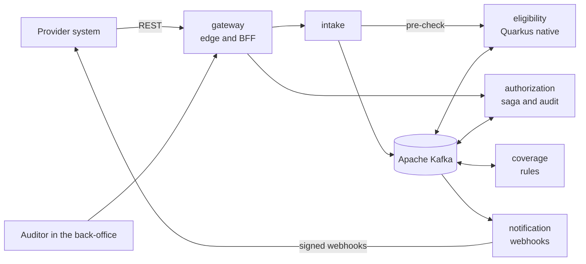

# careflow

Event-driven prior authorization for health plans.

[](docs/SPEC.md#13-roadmap)
[](LICENSE)
[](https://openjdk.org/projects/jdk/25/)

> **Status:** specification. Nothing is implemented yet; the code arrives milestone by milestone, following [docs/SPEC.md](docs/SPEC.md).

## What it is

In Brazilian supplementary health, clinics, labs and hospitals must ask the health plan for authorization before many procedures. careflow is the platform on the plan's side of that conversation:

- Providers submit requests through an idempotent REST API, safe to retry.
- The platform checks the beneficiary's eligibility (plan, coverage segment, waiting periods) and the plan's coverage rules, item by item.
- Routine requests are approved automatically within seconds, with a record of every rule that fired.
- Everything else goes to medical auditors, who work a queue ordered by response deadline in a React back-office.
- Providers hear about every change through signed webhooks.

It uses the public vocabulary of the ANS TISS standard and the TUSS terminology, with synthetic data only. careflow is not affiliated with any health plan.

## Architecture



Five services split by bounded context, each with its own PostgreSQL database, talk through Kafka. The authorization service orchestrates each request as a saga and owns its state machine. The full design, with sequence diagrams, data model, topics and decisions, is in the [specification](docs/SPEC.md#5-architecture).

## Highlights

Planned capabilities, each tied to a requirement in the spec:

- **Idempotent API.** `Idempotency-Key` on every write, RFC 9457 Problem Details on every error.
- **Graceful degradation.** If eligibility is slow or down, requests are still accepted and checked asynchronously.
- **No lost or duplicated decisions.** Transactional outbox, idempotent consumers, retry topics and dead-letter topics, proven by chaos tests and a reconciliation tool.
- **Explainable rules.** Versioned rule sets; each decision records the rules that fired.
- **Deadlines on business days.** Brazilian national holidays, warnings before a breach, alerts when it happens.
- **Four-eyes on high-cost items.** OPME approvals need a supervisor's confirmation.
- **Privacy by design (LGPD).** Encrypted clinical notes, masked CPF, an access log of who read what, retention purge.
- **Observable end to end.** One OpenTelemetry trace from the provider's request to the webhook, plus business dashboards in Grafana.
- **Runs anywhere.** One command locally; Helm chart for Kubernetes, with values for OpenShift.

## Tech stack

| Area | Technologies |
|---|---|
| Services | Java 25, Spring Boot 4, Quarkus 3 (native image), Spring Cloud Gateway, Resilience4j |
| Messaging | Apache Kafka 4 (KRaft), Avro, Apicurio Registry |
| Data | PostgreSQL 18, Flyway, Redis, MinIO |
| Security | Keycloak 26, OAuth2 and OIDC, BFF pattern |
| Front end | React 19, TypeScript, Vite, TanStack Query, Mantine |
| Observability | OpenTelemetry, Grafana, Tempo, Loki |
| Testing | JUnit 5, ArchUnit, Testcontainers, Pact, Playwright, Gatling, Toxiproxy, PIT |
| Delivery | GitHub Actions, Jib, GHCR, Trivy, CycloneDX, CodeQL, Helm, kind, Strimzi, CloudNativePG |

## Roadmap

| Milestone | Outcome | Status |
|---|---|---|
| M0 Foundation | Modules, CI, local infrastructure with one command, first ADRs | planned |
| M1 Walking skeleton | A request flows from the API through Kafka to an automatic approval | planned |
| M2 Eligibility and adjudication | Real decisions with explanations; graceful degradation | planned |
| M3 Medical audit | Back-office, claims, per-item decisions, deadlines, attachments | planned |
| M4 Notifications | Signed webhooks with retries, dead deliveries, e-mail | planned |
| M5 Production readiness | Dashboards, LGPD hardening, load and chaos tests, Helm and OpenShift | planned |
| M6 Showcase | Demo GIF, case study, `v1.0.0` | planned |

Each milestone's tasks and exit criteria are in [§13 of the spec](docs/SPEC.md#13-roadmap).

## Getting started

There is nothing to run yet. Milestone M0 delivers the local environment; from then on the whole platform starts with:

```sh
make up
```

The prerequisites (Docker, Java 25, Node.js) and every command will be documented in `docs/development.md` as part of M0.

## Documentation

- [Specification](docs/SPEC.md): goals, domain, requirements, architecture, interfaces, decisions, testing and roadmap.
- `docs/adr/`: architecture decision records, starting in M0.

## Related projects

- [idempotency-kit](https://github.com/eduardo-alecrim/idempotency-kit): the Idempotency-Key library careflow adopts once it is released.
- [legacy-modernization](https://github.com/eduardo-alecrim/legacy-modernization): a SOAP and Oracle monolith migrated to Quarkus with the strangler fig pattern.
- [trilho](https://github.com/eduardo-alecrim/trilho): a distributed commit log built from scratch in Java.

## License

[Apache License 2.0](LICENSE).

---

A portfolio project by [Eduardo Alecrim](https://eduardo-alecrim.github.io).
