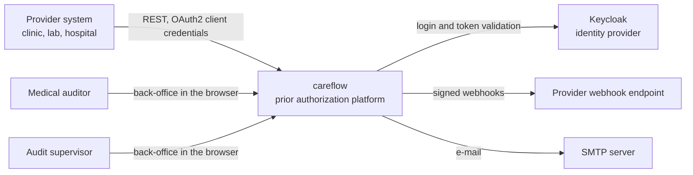
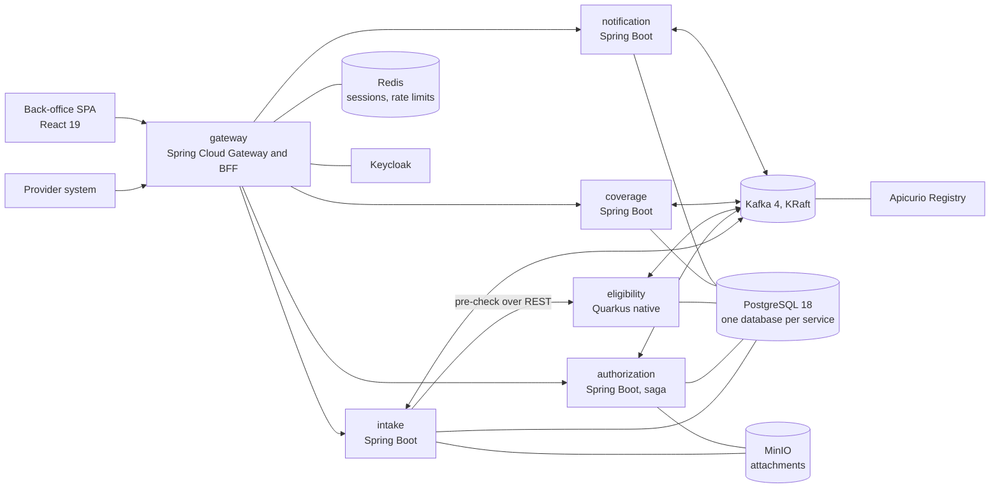
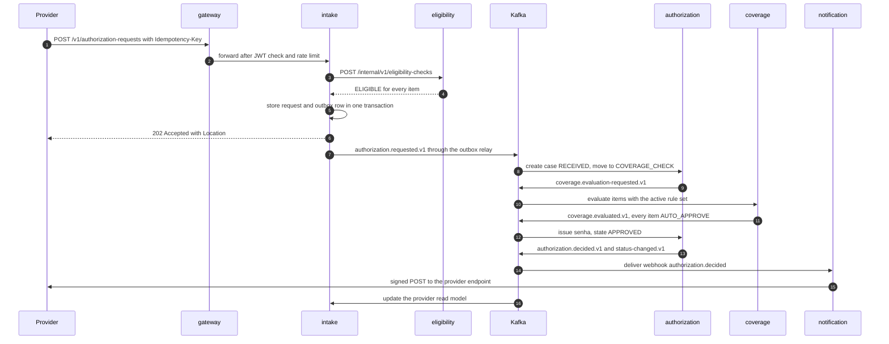
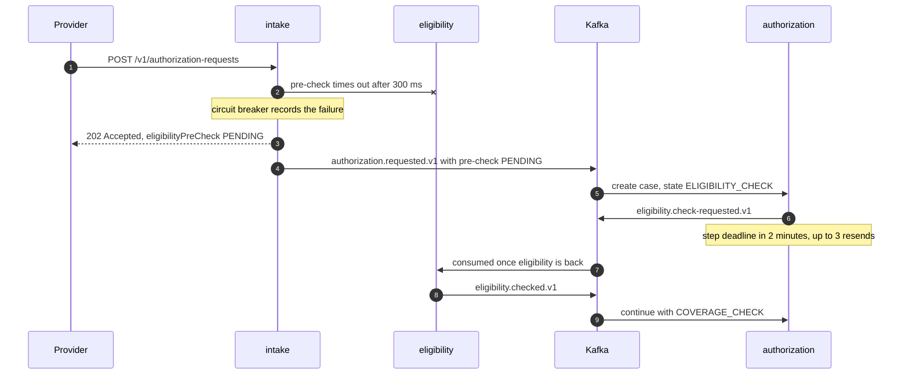
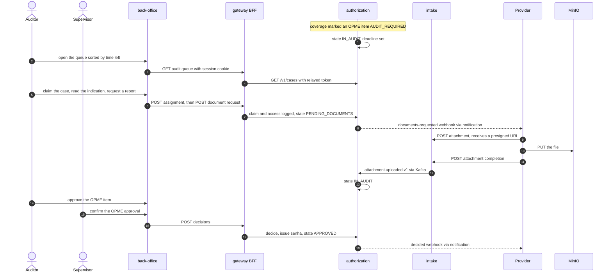
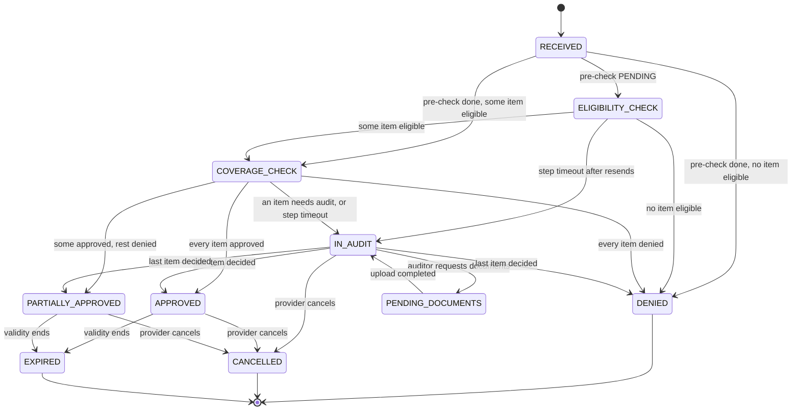
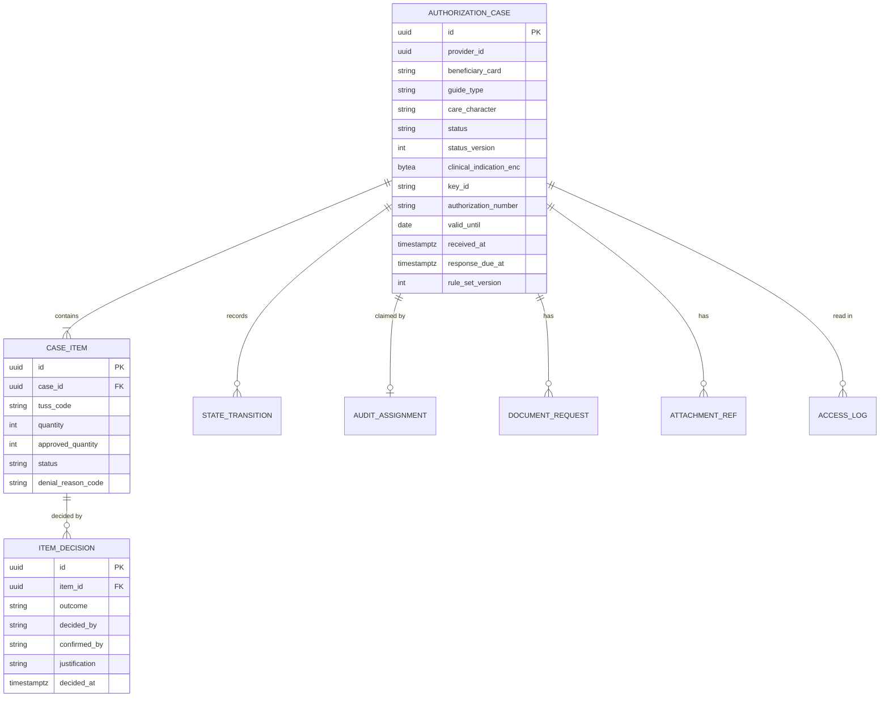

# careflow — Specification

careflow is an event-driven platform for prior authorization in Brazilian supplementary health. Providers submit authorization requests for procedures through an idempotent REST API. The platform checks the beneficiary's eligibility and the plan's coverage, approves automatically what the rules allow, routes everything else to medical auditors in a back-office, tracks each request against its response deadline and notifies the provider through signed webhooks. It is built as five Java services (Spring Boot and Quarkus) around Apache Kafka, with a React back-office, Keycloak for identity and OpenTelemetry from the first request to the last webhook.

**Status:** specification · **Last updated:** 2026-10-13

> careflow uses only public standards (the ANS TISS exchange standard and the TUSS terminology) and synthetic data. It is a portfolio project, is not affiliated with any health plan and must never hold real personal or health data.

## Contents

- [How to use this document](#how-to-use-this-document)
- [1. Why this project](#1-why-this-project)
- [2. Goals and non-goals](#2-goals-and-non-goals)
- [3. Domain](#3-domain)
- [4. Functional requirements](#4-functional-requirements)
- [5. Architecture](#5-architecture)
- [6. Data and interfaces](#6-data-and-interfaces)
- [7. Technology choices and decisions](#7-technology-choices-and-decisions)
- [8. Non-functional requirements](#8-non-functional-requirements)
- [9. Testing strategy](#9-testing-strategy)
- [10. Engineering practices and CI/CD](#10-engineering-practices-and-cicd)
- [11. Running and deploying](#11-running-and-deploying)
- [12. Repository layout](#12-repository-layout)
- [13. Roadmap](#13-roadmap)
- [14. Showcase checklist](#14-showcase-checklist)
- [15. Risks and mitigations](#15-risks-and-mitigations)
- [16. Out of scope and future ideas](#16-out-of-scope-and-future-ideas)
- [17. References](#17-references)

## How to use this document

- Each milestone in [§13](#13-roadmap) is a checklist. Every unchecked item becomes a GitHub issue, labelled with its milestone (`M1`, `M2`…) and grouped in a GitHub milestone of the same name.
- One branch and one pull request per issue (`feat/intake-idempotency`), squash-merged into `main`. PR titles follow [Conventional Commits](https://www.conventionalcommits.org) (`feat(intake): accept Idempotency-Key`), and CI enforces it.
- Requirement IDs (`BR-xx`, `FR-xx`, `NFR-xx`, `D-xx`) are stable. Reference them in issues, commit bodies and test names (`@DisplayName("FR-02 replays the stored response")`).
- The decisions in [§7](#7-technology-choices-and-decisions) are recorded as ADRs in `docs/adr/` during M0, starting with `0001-record-architecture-decisions.md`. Changing a decision means a new ADR that supersedes the old one, and this spec is updated in the same PR.
- When the implementation shows that this document is wrong, the document is fixed. It describes the system as built, not as first imagined.

## 1. Why this project

Prior authorization is where a health plan's rules meet a provider's urgency. A request arrives with a beneficiary, a list of procedures and a clinical indication. For each item the plan has to decide whether the person is covered, whether the waiting periods are over, whether usage limits allow it and whether a physician must review it, and it has to answer within a deadline. Done by hand, the process is slow and inconsistent. Done by one synchronous system, a single slow dependency stalls every provider at the counter.

The domain is rich enough to exercise every concern of a distributed backend: idempotent APIs, an orchestrated saga with timeouts, explainable rules, sensitive personal data, deadlines counted in business days and a human work queue that must never lose a case.

| Skill area | Where it shows up |
|---|---|
| Domain-driven design | Bounded contexts as services ([§5.2](#52-containers)), glossary and business rules ([§3](#3-domain)), request state machine ([§5.5](#55-request-state-machine)) |
| Hexagonal architecture | Ports and adapters in every service, enforced by ArchUnit (D-10) |
| Event-driven architecture | Kafka topics with Avro contracts, orchestrated saga, CQRS read model (D-02, D-12) |
| Reliability patterns | Transactional outbox, inbox, retry topics and DLT, circuit breaker with graceful degradation (D-03, D-05, FR-04) |
| API design | Idempotency-Key, RFC 9457 Problem Details, cursor pagination, Standard Webhooks signatures ([§6](#6-data-and-interfaces)) |
| Two Java stacks | Spring Boot 4 services and a Quarkus eligibility service compiled to a native image (D-06) |
| Security | Keycloak, OAuth2 client credentials, BFF with session cookie, OWASP ASVS level 2 subset (NFR-09) |
| Privacy (LGPD) | Field-level encryption, CPF masking, access audit log, retention purge (NFR-10) |
| Front end | React 19 back-office with TanStack Query and Mantine, WCAG 2.2 AA (NFR-11) |
| Observability | OpenTelemetry traces across Kafka, RED and business metrics, dashboards as code (NFR-06, NFR-07) |
| Testing | Testcontainers, Pact, Gatling, chaos tests with Toxiproxy, PIT mutation testing ([§9](#9-testing-strategy)) |
| Delivery | GitHub Actions, Jib images on GHCR, SBOM, Trivy, CodeQL, Helm on kind, OpenShift-ready values ([§10](#10-engineering-practices-and-cicd), [§11](#11-running-and-deploying)) |

## 2. Goals and non-goals

### Goals

- **G-01** A provider gets a decision for a routine request within seconds, with no human involved.
- **G-02** No request is lost, decided twice or left without an owner, even when a service or the broker fails mid-flow.
- **G-03** Every decision is explainable: which rule set version applied, which rules fired, who decided and why.
- **G-04** Auditors work from a queue ordered by deadline, and the platform warns before a deadline is breached.
- **G-05** The platform runs locally with one command and deploys to Kubernetes and OpenShift with the same images.
- **G-06** The repository reads as a reference: documented decisions, tests that tell the story, numbers backed by evidence.

### Non-goals

- Billing, claims and invoice disallowances (faturamento and glosas).
- Full TISS XML message exchange. M6 adds one XML ingestion endpoint as a stretch goal; nothing else.
- Provider credentialing and contract management. Provider data is seeded.
- Procedure execution at the point of care (check-in, biometrics, execution tokens).
- Multi-tenancy. One deployment serves one operator.
- Multi-region high availability. The Kubernetes profile targets a single cluster.

## 3. Domain

### 3.1 Glossary

| Term | Portuguese | Meaning |
|---|---|---|
| Operator | Operadora | Organization that runs the health plan and owns careflow. |
| ANS | Agência Nacional de Saúde Suplementar | Regulator of supplementary health in Brazil; publishes TISS and TUSS. |
| TISS | Troca de Informações na Saúde Suplementar | Mandatory standard for data exchange between operators and providers: guides, messages and terminologies. |
| TUSS | Terminologia Unificada da Saúde Suplementar | Unified terminology. Table 22 lists procedures and events in health, each with an 8-digit code. |
| Beneficiary | Beneficiário | Person covered by a plan, identified by a card number (carteirinha). |
| Provider | Prestador | Clinic, laboratory or hospital in the operator's network (rede credenciada). |
| Plan | Plano | Product a beneficiary holds; defines segments, waiting periods and coverage. |
| Coverage segment | Segmentação | Ambulatorial, hospitalar (with or without obstetrics), odontológica or referência. A procedure is covered only inside its segments. |
| Waiting period | Carência | Time after contract start before a group of procedures is covered. |
| Guide | Guia | TISS form that carries a request. careflow handles SP/SADT (exams and therapies) and solicitação de internação (hospital admission). |
| Character of care | Caráter de atendimento | Elective (eletivo) or urgency/emergency (urgência/emergência); drives the response deadline. |
| Item | Item da guia | One procedure on a request: TUSS code and quantity. |
| OPME | Órteses, próteses e materiais especiais | Orthoses, prostheses and special materials. Always reviewed by an auditor. |
| Authorization number | Senha | Code issued on approval, valid until an expiry date. |
| Medical audit | Auditoria médica | Clinical review of a request by a physician auditor. |
| Response deadline | Prazo de resposta | Time the operator has to answer a request; modelled as an SLA policy. |
| Denial reason | Motivo de negativa | Coded reason for denying an item, taken from the TISS message terminology. |
| Rule set | — | Versioned set of coverage and adjudication rules (careflow concept). |
| Case | — | An authorization request as seen by the audit team (careflow concept). |

### 3.2 Business rules

| ID | Rule | Enforced by |
|---|---|---|
| BR-01 | Only active providers can submit requests, and a provider sees only its own requests. | gateway, intake |
| BR-02 | The beneficiary must be active (not suspended or cancelled) on the date the request is received. | eligibility |
| BR-03 | An item is covered only if its procedure belongs to a segment of the beneficiary's plan. A solicitação de internação requires a hospital segment. | eligibility, coverage |
| BR-04 | The waiting period of the item's procedure group must be over on the receipt date. Urgent requests use the urgent waiting period of the plan (seeded as 24 hours). | eligibility |
| BR-05 | An item cannot exceed its usage limit (quantity per beneficiary per rolling period). Approved quantities consume the limit; cancellation and expiry release it. | coverage |
| BR-06 | OPME items and items whose reference value exceeds the audit threshold go to medical audit. | coverage |
| BR-07 | Procedures flagged `requiresAudit` in the active rule set go to medical audit. | coverage |
| BR-08 | The same procedure for the same beneficiary with an open or approved request in the last 30 days (configurable) goes to medical audit as a possible duplicate. | coverage |
| BR-09 | An item that passes every rule is approved automatically. | coverage, authorization |
| BR-10 | The request status aggregates its items: all approved → `APPROVED`; some approved and the rest denied → `PARTIALLY_APPROVED`; all denied → `DENIED`; any item in audit → `IN_AUDIT`. | authorization |
| BR-11 | Any approval issues one senha per request, valid for 30 days by default. Approved requests expire when the validity ends. | authorization |
| BR-12 | Every request has a response deadline from its SLA policy (guide type and character of care), counted in business days or in hours. A warning is raised at 80% of the time elapsed and a breach at 100%. | authorization |
| BR-13 | Requesting documents does not pause the response deadline. | authorization |
| BR-14 | Denying an item requires a denial reason; an auditor's denial also requires a written justification. | authorization |
| BR-15 | Approving an OPME item requires confirmation by a second person with the supervisor role (four-eyes). | authorization |
| BR-16 | A provider may cancel a request before it reaches a terminal state. Cancelling an approved request invalidates its senha. | intake, authorization |

### 3.3 Seed data

- **Procedures.** A sample of 40 to 60 procedures copied verbatim (code and description) from the published TUSS table 22: consultations, laboratory tests, imaging, therapies, surgeries and procedures that involve OPME. The table version and download date are recorded in `platform/seed/tuss/SOURCE.md`. Codes are never invented. The attributes careflow adds to each procedure (`requiresAudit`, reference value, usage limit, procedure group) are synthetic and labelled as such.
- **Denial reasons.** A sample from the TISS message terminology, recorded the same way in `platform/seed/tiss/SOURCE.md`.
- **Beneficiaries, plans and providers.** Generated with Datafaker (pt-BR locale) from a fixed seed, so every run produces the same data. CPFs are synthetic with a valid check digit, card numbers start with `SYN`, e-mail addresses use the reserved `example.com` domain.

### 3.4 Deadlines and business calendar

- Time zone: `America/Sao_Paulo`. Timestamps are stored in UTC.
- Business days: Monday to Friday, except national holidays. Fixed holidays: 1 January, 21 April, 1 May, 7 September, 12 October, 2 November, 15 November, 20 November and 25 December. Good Friday is computed from Easter Sunday. Carnival Monday and Tuesday and Corpus Christi are optional days off (pontos facultativos), switched on or off in configuration.
- Business-day deadlines end at the same time of day N business days later. A request received on a non-business day starts counting at 00:00 of the next business day.
- Hour deadlines (urgent care) run on calendar time.
- Seeded SLA policies, illustrative and configurable, **not** regulatory values: `URGENT` any guide → 6 hours; `ELECTIVE` SP/SADT → 3 business days; `ELECTIVE` internação → 5 business days; any request with OPME → 10 business days. When several policies match, the shortest deadline wins.

## 4. Functional requirements

### 4.1 Provider API

**FR-01 Submit a request.** A provider submits `POST /v1/authorization-requests` with a guide type (`SP_SADT` or `INTERNACAO`), character of care (`ELECTIVE` or `URGENT`), beneficiary card number, requesting professional (council, state, number), clinical indication (up to 4,000 characters) and 1 to 20 items (TUSS code, quantity 1–99). The service answers `202 Accepted` with the request ID, status `RECEIVED`, the pre-check result, the response deadline and a `Location` header.

- *Given* an authenticated provider and a valid body, *when* it submits the request, *then* the response is `202` with a `Location` of `/v1/authorization-requests/{id}`, and one `careflow.authorization.requested.v1` event is published for that ID.
- *Given* an item with a TUSS code absent from the catalogue, *when* it submits, *then* the response is `422` with problem type `urn:careflow:problem:unknown-procedure` and the JSON pointer of the item.

**FR-02 Idempotent submission.** `POST` and cancellation endpoints require an `Idempotency-Key` header, following the IETF Idempotency-Key draft. Keys are scoped by provider, method and path, and kept for 24 hours.

- *Given* a request accepted with key `K`, *when* the provider repeats it with key `K` and the same body, *then* it gets the original status code and body, plus `Idempotent-Replayed: true`, and no new event is published.
- *Given* key `K` used with body `A`, *when* the provider sends key `K` with body `B`, *then* the response is `422` (`urn:careflow:problem:idempotency-key-reused`).
- *Given* a request with key `K` still in progress, *when* a second one arrives with key `K`, *then* the response is `409` (`urn:careflow:problem:request-in-progress`).
- *Given* no `Idempotency-Key` header, *when* the provider submits, *then* the response is `400` (`urn:careflow:problem:idempotency-key-missing`).

**FR-03 Error responses.** Every error is an RFC 9457 Problem Details document ([§6.8](#68-error-model)): `400` for malformed or invalid input (with an `errors` array of JSON pointers), `401`/`403` for authentication and authorization, `404` for unknown or foreign IDs, `409`, `415`, `422` for semantic errors and `429` when the provider exceeds its rate limit (50 requests per second by default, enforced at the gateway).

**FR-04 Eligibility pre-check with graceful degradation.** Before accepting, intake calls the eligibility service synchronously (timeout 300 ms, circuit breaker) and stores the per-item result, summarized as `ELIGIBLE`, `PARTIAL` or `INELIGIBLE`. An unknown beneficiary is rejected with `422`; an ineligible one is accepted and denied by the saga, so the provider gets a coded reason and the request has a record. When the call fails or the circuit is open, intake still accepts the request with `eligibilityPreCheck: PENDING`, and the saga checks eligibility asynchronously.

- *Given* the eligibility service is down, *when* a provider submits a valid request, *then* the response is `202` with `eligibilityPreCheck: PENDING` within the latency target of NFR-01, and the request later reaches a decision once eligibility is back.
- *Given* 10 consecutive failed pre-checks, *when* the next request arrives, *then* the circuit is open and intake does not call eligibility for 30 seconds.

**FR-05 Read a request.** `GET /v1/authorization-requests/{id}` returns status, `statusVersion`, per-item status, senha and validity when approved, denial reasons and the response deadline. A provider asking for another provider's request gets `404`, so IDs cannot be probed.

**FR-06 List requests.** `GET /v1/authorization-requests` filters by status, card number and receipt period, sorted by receipt time, with cursor pagination (`limit` up to 100, opaque `cursor`).

**FR-07 Cancel a request.** `POST /v1/authorization-requests/{id}/cancellation` (with `Idempotency-Key`) cancels a non-terminal request (BR-16) and answers `202`. Cancelling a terminal request answers `409`.

**FR-08 Upload attachments.** `POST /v1/authorization-requests/{id}/attachments` with file name, media type (`application/pdf`, `image/jpeg`, `image/png`) and size (up to 10 MB) returns an attachment ID and a presigned `PUT` URL valid for 10 minutes. `POST /v1/authorization-requests/{id}/attachments/{attachmentId}/completion` confirms the upload; intake checks that the object exists with the declared size and publishes `careflow.attachment.uploaded.v1`.

### 4.2 Adjudication

**FR-09 Eligibility evaluation.** The eligibility service evaluates each item against BR-02 to BR-04 as of the receipt date and returns `ELIGIBLE` or `INELIGIBLE` with a reason (`BENEFICIARY_INACTIVE`, `SEGMENT_NOT_COVERED`, `WAITING_PERIOD`). The same logic serves the REST pre-check and the `careflow.eligibility.check-requested.v1` command.

**FR-10 Coverage evaluation.** The coverage service evaluates each eligible item with the rule set active at the receipt date and returns `AUTO_APPROVE`, `DENY` (with a TISS denial reason) or `AUDIT_REQUIRED` (with the triggering rule). Each evaluation stores the rule set version and the ordered list of rules that fired, with their inputs and outcome.

**FR-11 Usage counters.** The coverage service keeps approved quantities per beneficiary, procedure and period. It consumes `careflow.authorization.decided.v1` to consume quantities and cancellation or expiry events to release them, idempotently by event ID.

**FR-12 Automatic decision.** When no item needs audit, the authorization service decides the request without human action, applies BR-10 and BR-11 and publishes `careflow.authorization.decided.v1`.

- *Given* a request whose items all pass every rule, *when* the coverage result arrives, *then* the request is `APPROVED`, a senha valid for 30 days is issued, and the decision event is published exactly once.
- *Given* two items where one fails its waiting period, *when* both results arrive, *then* the request is `PARTIALLY_APPROVED` and the failed item carries the denial reason.

**FR-13 Saga step timeouts.** Each saga step (eligibility check, coverage evaluation) has a deadline of 2 minutes. On timeout the orchestrator re-sends the command (consumers are idempotent) up to 3 times, then moves the request to `IN_AUDIT` with reason `SYSTEM_TIMEOUT`, so a person owns it.

### 4.3 Medical audit and deadlines

**FR-14 Audit queue.** Auditors see the requests in `IN_AUDIT` and `PENDING_DOCUMENTS`, sorted by time left to the deadline, with filters for guide type, character of care, OPME and assignee.

**FR-15 Claiming cases.** An auditor claims a case before deciding. A claim is exclusive and is released automatically after 30 minutes without activity. Supervisors can reassign any case.

- *Given* auditor A holds a case, *when* auditor B tries to claim it, *then* B gets `409` and the case stays with A.

**FR-16 Per-item decision.** The assigned auditor approves (optionally with a reduced quantity) or denies each item under audit. Denials need a reason and a justification (BR-14). OPME approvals stay `AWAITING_CONFIRMATION` until a supervisor confirms them (BR-15). When the last item is decided, BR-10 and BR-11 apply.

- *Given* an OPME item approved by an auditor, *when* the same auditor tries to confirm it, *then* the response is `403`; *when* a supervisor confirms it, *then* the item is approved and the request is decided.

**FR-17 Document requests.** An auditor can request documents with a free-text description. The request moves to `PENDING_DOCUMENTS`, the provider is notified, and the first completed upload moves it back to `IN_AUDIT`. The deadline keeps running (BR-13).

**FR-18 Deadlines.** On receipt, the authorization service computes `responseDueAt` from the SLA policy and the business calendar ([§3.4](#34-deadlines-and-business-calendar)). A scheduler publishes `careflow.authorization.sla-warning.v1` at 80% of the time elapsed and `careflow.authorization.sla-breached.v1` at 100%, once each.

- *Given* an elective SP/SADT request received on a Friday at 16:00 with a 3-business-day policy and a national holiday on Monday, *when* the deadline is computed, *then* it is Thursday at 16:00 (America/Sao_Paulo).

**FR-19 Senha and expiry.** Senhas are 12 characters from an unambiguous alphabet (no `0/O`, `1/I/L`), unique, and not derived from the request ID. A daily job moves approved requests past their validity to `EXPIRED`.

### 4.4 Notifications

**FR-20 Webhook subscription.** A provider manages one webhook URL with `GET`/`PUT /v1/webhook-subscription` and rotates its signing secret with `POST /v1/webhook-subscription/secret-rotation`. During rotation both secrets sign deliveries for 24 hours. URLs must be HTTPS outside the `local` profile.

**FR-21 Webhook delivery.** The notification service delivers `authorization.received`, `authorization.audit-required`, `authorization.documents-requested`, `authorization.decided`, `authorization.cancelled` and `authorization.expired` with the Standard Webhooks headers (`webhook-id`, `webhook-timestamp`, `webhook-signature`, HMAC-SHA256). Delivery is at least once and not ordered; each payload carries `statusVersion` so receivers can drop stale messages. A `2xx` answer within 5 seconds counts as delivered.

**FR-22 Retries and dead deliveries.** Failed deliveries are retried after 30 s, 2 min, 10 min, 30 min, 1 h and 2 h. After the 7th failed attempt the delivery becomes `DEAD`, a metric is incremented, and a supervisor can redeliver it from the back-office.

- *Given* a webhook endpoint that answers `500` for 40 minutes, *when* a decision is published, *then* the delivery succeeds on the 5th attempt and the delivery log shows 4 failures with status codes and latencies.

**FR-23 E-mail.** Providers that opt in receive an e-mail on decisions and document requests. Supervisors receive an e-mail on each SLA breach. Locally, Mailpit captures every message.

### 4.5 Back-office and governance

**FR-24 Case detail.** The case page shows the request, the clinical indication (decrypted on demand), attachments (download through presigned URLs valid for 5 minutes), per-item eligibility and coverage results with the rules that fired, and a timeline of every state transition and event.

**FR-25 Access audit log.** Every read of a case detail, clinical indication or attachment is recorded with user, role, case, action, timestamp and trace ID. Supervisors can export the log for a period as CSV.

**FR-26 KPI dashboard.** The back-office shows, for a chosen period: requests received, auto-approval rate, decisions by outcome, median and p90 time to decision (auto and audit), SLA compliance rate, open cases by time left and dead webhook deliveries.

**FR-27 Rule sets.** Rule sets are versioned and immutable once published, with an `effectiveFrom` timestamp. Admins publish a new version through `POST /v1/rule-sets` on the coverage service. The back-office shows the versions and their rules read-only, and each decision links to the version it used.

**FR-28 SLA policies.** The back-office lists SLA policies and the holiday calendar read-only. Admins change them through the authorization service API; changes affect only requests received afterwards.

### 4.6 Tooling

**FR-29 Provider simulator.** `tools/provider-simulator` generates traffic from N synthetic providers at a configurable rate and mix (elective/urgent, SP/SADT/internação, OPME share, 10% retries with the same Idempotency-Key, 1% conflicting reuse). It hosts a webhook receiver that verifies signatures and can be told to fail a share of deliveries.

**FR-30 Reconciliation.** `tools/reconcile` compares the requests accepted by intake with the cases in the authorization service and exits non-zero if any request older than 5 minutes has no case, has more than one decision event or is outside a terminal or audit state.

- *Given* a load test during which the broker and the authorization service were killed, *when* reconciliation runs after recovery, *then* it reports zero missing, duplicated or stuck requests.

## 5. Architecture

### 5.1 System context



### 5.2 Containers



Every service exports traces, metrics and logs over OTLP to `grafana/otel-lgtm` (Grafana, Loki, Tempo and a Prometheus-compatible metrics store), left out of the diagram for clarity.

| Container | Responsibility | Owns |
|---|---|---|
| `gateway` | Edge for the provider API (JWT check, rate limit per `provider_id`, routing); BFF for the back-office (OAuth2 login, session cookie, CSRF, token relay); security headers. | Sessions in Redis |
| `intake` | Provider-facing API: validation, idempotency, eligibility pre-check, attachments, cancellation; provider read model fed by status events. | `intake` database, attachment bucket |
| `eligibility` | Beneficiary registry (plans, segments, waiting periods, status) and eligibility evaluation, over REST and Kafka. | `eligibility` database |
| `coverage` | Procedure catalogue, rule sets, rule evaluation with traces, usage counters. | `coverage` database |
| `authorization` | Saga orchestrator; request lifecycle and state machine; senha; audit queue, claims and decisions; deadlines and calendar; access audit log; KPIs. | `authorization` database |
| `notification` | Webhook subscriptions, signed deliveries, retries, dead deliveries and redelivery; e-mail. | `notification` database |
| `web/backoffice` | Auditor and supervisor UI, served as static files behind the gateway. | — |

### 5.3 Back-office

React 19 with strict TypeScript, Vite, TanStack Query for server state, React Router, Mantine components and React Hook Form with Zod. API types are generated from `contracts/openapi` with `openapi-typescript`, and CI fails when they are stale. Pages: audit queue, case detail, decision form, documents, KPI dashboard, webhook deliveries and access log export (supervisor), rule sets and SLA policies (read-only). The SPA never sees a token: it calls `/bff/api/**` on its own origin with the session cookie and an `X-XSRF-TOKEN` header. Mock Service Worker stands in for the BFF in component tests and in `npm run dev:mock`.

### 5.4 Key flows

**Automatic approval**



**Degraded pre-check**



**Medical audit with a document request**



### 5.5 Request state machine



Every non-terminal state can move to `CANCELLED` (only one such arrow is drawn). The state machine is a pure domain class (`AuthorizationCase.apply(event)`) with an explicit transition table; illegal transitions throw `IllegalTransitionException` and are covered by a parameterized test over every state and event pair. Each transition increments `statusVersion`, appends a row to `state_transition` and writes the outgoing events to the outbox in the same transaction.

Item states: `PENDING`, `ELIGIBLE`, `INELIGIBLE`, `AUTO_APPROVED`, `IN_AUDIT`, `AWAITING_CONFIRMATION`, `APPROVED`, `DENIED`, `CANCELLED`.

### 5.6 Inside a service

Every service follows the same hexagonal layout under `io.github.eduardoalecrim.careflow.<service>`:

```text
domain/                 entities, value objects, domain events, policies (no framework imports)
application/            use cases; ports in application/port/in and application/port/out
adapter/in/web/         REST controllers or JAX-RS resources, DTOs, Problem Details mapping
adapter/in/messaging/   Kafka listeners, inbox check
adapter/out/persistence/ JPA or Panache entities and repositories, mappers
adapter/out/messaging/  outbox writer, Avro mappers
adapter/out/http/       REST clients
config/                 wiring
```

ArchUnit rules, shared through `libs/test-support` and run in every service build:

- `domain` depends on nothing outside `java.*` and `domain` itself.
- `application` depends only on `domain`; adapters depend on `application` ports, never on each other.
- Controllers and listeners do not access repositories directly.
- No class in `domain` or `application` is annotated with Spring, Jakarta Persistence or Quarkus annotations.
- Cycles between packages are forbidden.

### 5.7 Reliability mechanisms

- **Transactional outbox.** State changes and outgoing events are written in one database transaction to `outbox_event (id, aggregate_id, topic, message_key, payload bytea, headers jsonb, created_at, published_at)`. A relay polls every 200 ms with `SELECT … WHERE published_at IS NULL ORDER BY id LIMIT 100 FOR UPDATE SKIP LOCKED`, sends with an idempotent producer (`acks=all`, `enable.idempotence=true`), then sets `published_at`. Only one relay instance per service is active at a time, elected with a PostgreSQL advisory lock, so events for the same key are published in commit order. Published rows are deleted after 7 days. Shared code lives in `libs/outbox-spring`; eligibility has a small Quarkus equivalent.
- **Inbox.** Every consumer inserts `(event_id, consumer)` into `processed_event` in the same transaction as its side effects. A duplicate key means the event was already handled, and it is acknowledged without effect.
- **Retry topics and DLT.** Spring services use `@RetryableTopic` (4 attempts, backoff 1 s doubling). Deserialization and validation errors skip retries and go straight to the dead-letter topic. A DLT listener stores the record in `dead_letter` and increments `careflow_dead_letters_total`; admins replay it with `POST /admin/dead-letters/{id}/replay`. Eligibility uses SmallRye's dead-letter-queue failure strategy with the same naming.
- **Saga timeouts.** Step deadlines live in `saga_step` rows. A scheduler protected by ShedLock scans every 15 seconds and re-sends or escalates (FR-13).
- **Circuit breaker.** Resilience4j on the intake to eligibility call: time limiter 300 ms, sliding window of 20 calls, opens at 50% failures or 10 consecutive failures, half-open after 30 s with 5 trial calls.
- **Consumer tolerance.** Consumers treat events as possibly duplicated and possibly reordered. The provider read model ignores any status event whose `statusVersion` is not newer than the stored one.

## 6. Data and interfaces

### 6.1 Data ownership

| Service | Database | Main tables |
|---|---|---|
| intake | `intake` | `authorization_request`, `request_item`, `attachment`, `idempotency_record`, `provider_view`, `outbox_event`, `processed_event` |
| eligibility | `eligibility` | `beneficiary`, `plan`, `plan_segment`, `waiting_period`, `procedure_group`, `outbox_event`, `processed_event` |
| coverage | `coverage` | `procedure`, `rule_set`, `rule_set_rule`, `evaluation`, `evaluation_rule_trace`, `usage_counter`, `outbox_event`, `processed_event` |
| authorization | `authorization` | see diagram below, plus `sla_policy`, `holiday`, `saga_step`, `outbox_event`, `processed_event`, `dead_letter` |
| notification | `notification` | `webhook_subscription`, `webhook_secret`, `delivery`, `delivery_attempt`, `email_message`, `processed_event` |

Schemas are managed by Flyway in each service. No service reads another service's database; the only shared instance is a local-footprint choice (D-09).

### 6.2 Authorization data model



The other tables: `state_transition` (from, to, trigger, actor, time), `audit_assignment` (auditor, claimed at, last activity), `document_request` (description, requested by, requested and fulfilled at), `attachment_ref` (object key, media type, size) and `access_log` (user, role, action, trace ID, time). IDs are UUIDv7 (time-ordered) for index locality. `beneficiary_card` is the synthetic card number; the CPF never leaves the eligibility service, which stores it as an HMAC for lookups plus a masked form for display (`***.456.789-**`).

### 6.3 Provider API

All paths are served by the gateway on `https://<host>/` and routed to intake. Authentication: `Authorization: Bearer <token>` from the client credentials grant; the token carries a `provider_id` claim.

| Method | Path | Purpose | Success |
|---|---|---|---|
| POST | `/v1/authorization-requests` | Submit a request (FR-01, FR-02, FR-04) | 202 |
| GET | `/v1/authorization-requests/{id}` | Read a request (FR-05) | 200 |
| GET | `/v1/authorization-requests` | List requests with filters and cursor (FR-06) | 200 |
| POST | `/v1/authorization-requests/{id}/cancellation` | Cancel (FR-07) | 202 |
| POST | `/v1/authorization-requests/{id}/attachments` | Start an upload, get a presigned URL (FR-08) | 201 |
| POST | `/v1/authorization-requests/{id}/attachments/{attachmentId}/completion` | Confirm an upload (FR-08) | 204 |
| GET / PUT | `/v1/webhook-subscription` | Read or set the webhook URL (FR-20) | 200 |
| POST | `/v1/webhook-subscription/secret-rotation` | Rotate the signing secret (FR-20) | 200 |

Submit request (the TUSS codes are placeholders; real calls use codes from the seeded catalogue):

```json
{
  "guideType": "SP_SADT",
  "careCharacter": "ELECTIVE",
  "beneficiary": { "cardNumber": "SYN0000123456" },
  "requestingProfessional": { "council": "CRM", "state": "DF", "number": "000000" },
  "clinicalIndication": "Synthetic text. Encrypted at rest and never logged.",
  "items": [
    { "tussCode": "<TUSS-22-CODE>", "quantity": 1 },
    { "tussCode": "<TUSS-22-CODE>", "quantity": 2 }
  ]
}
```

`202 Accepted`, `Location: /v1/authorization-requests/0199d7a2-6c4e-7b1a-9f3e-2a51c0d4e8b7`:

```json
{
  "requestId": "0199d7a2-6c4e-7b1a-9f3e-2a51c0d4e8b7",
  "status": "RECEIVED",
  "statusVersion": 1,
  "eligibilityPreCheck": "ELIGIBLE",
  "receivedAt": "2026-10-13T14:02:11Z",
  "responseDueAt": "2026-10-16T14:02:11Z"
}
```

`GET /v1/authorization-requests/{id}` returns the same fields plus `items` (with per-item `status`, `approvedQuantity` and `denialReason`), `authorizationNumber`, `validUntil` and `decidedAt`, shaped like the webhook payload in [§6.7](#67-webhook-payload).

### 6.4 Back-office API (BFF)

The gateway exposes `/bff/api/**` to the SPA and strips the prefix when relaying to the owning service, so contracts are defined and verified on the services' own paths.

| Method | BFF path | Service and path | Role |
|---|---|---|---|
| GET | `/bff/api/me` | gateway | any |
| GET | `/bff/api/cases?queue=audit&sort=timeLeft` | authorization `GET /v1/cases` | auditor |
| GET | `/bff/api/cases/{id}` | authorization `GET /v1/cases/{id}` (logged) | auditor |
| GET | `/bff/api/cases/{id}/clinical-indication` | authorization (decrypts, logged) | auditor |
| POST / DELETE | `/bff/api/cases/{id}/assignment` | authorization (claim or release) | auditor |
| PUT | `/bff/api/cases/{id}/assignment` | authorization (reassign) | supervisor |
| POST | `/bff/api/cases/{id}/decisions` | authorization | auditor |
| POST | `/bff/api/cases/{id}/items/{itemId}/confirmation` | authorization (four-eyes) | supervisor |
| POST | `/bff/api/cases/{id}/document-requests` | authorization | auditor |
| GET | `/bff/api/attachments/{id}/download-url` | authorization (logged) | auditor |
| GET | `/bff/api/kpis?from=&to=` | authorization | supervisor |
| GET | `/bff/api/access-log.csv?from=&to=` | authorization | supervisor |
| GET | `/bff/api/rule-sets`, `/bff/api/rule-sets/{version}` | coverage | auditor |
| GET | `/bff/api/sla-policies`, `/bff/api/holidays?year=` | authorization | auditor |
| GET | `/bff/api/deliveries?status=DEAD` | notification | supervisor |
| POST | `/bff/api/deliveries/{id}/redelivery` | notification | supervisor |

### 6.5 Internal and admin API

`POST /internal/v1/eligibility-checks` (eligibility, called by the intake pre-check), `GET /internal/v1/reconciliation?receivedBefore=` (intake and authorization, called by `tools/reconcile`), `POST /v1/rule-sets` (coverage, admin), `PUT /v1/sla-policies/{id}` (authorization, admin) and `POST /admin/dead-letters/{id}/replay` (every Spring service, admin). They require a token with the `careflow-internal` audience or the `admin` role; in Kubernetes a NetworkPolicy also restricts which pods reach them.

### 6.6 Events

Topic names follow `careflow.<context>.<event>.v<major>`. Every topic has 6 partitions (replication factor 1 in compose, 3 in Kubernetes) and is keyed by `requestId`, so all events of a request land on one partition in order. Values are Avro, registered in Apicurio Registry with `BACKWARD` compatibility. Headers: `traceparent` (W3C, set by the instrumentation), `eventType`, `contentType`.

| Topic | Producer | Consumers | Meaning |
|---|---|---|---|
| `careflow.authorization.requested.v1` | intake | authorization | A request was accepted |
| `careflow.authorization.cancellation-requested.v1` | intake | authorization | A provider asked to cancel |
| `careflow.attachment.uploaded.v1` | intake | authorization | An upload was completed |
| `careflow.eligibility.check-requested.v1` | authorization | eligibility | Command: check these items |
| `careflow.eligibility.checked.v1` | eligibility | authorization | Per-item eligibility result |
| `careflow.coverage.evaluation-requested.v1` | authorization | coverage | Command: evaluate these items |
| `careflow.coverage.evaluated.v1` | coverage | authorization | Per-item coverage result and rule trace ID |
| `careflow.authorization.status-changed.v1` | authorization | intake, notification | Any state transition, with `statusVersion` |
| `careflow.authorization.decided.v1` | authorization | notification, coverage | Final decision per item, senha and validity |
| `careflow.authorization.audit-required.v1` | authorization | notification | Request entered medical audit |
| `careflow.authorization.sla-warning.v1` | authorization | notification | 80% of the deadline elapsed |
| `careflow.authorization.sla-breached.v1` | authorization | notification | Deadline breached |

Retry topics and dead-letter topics use Spring Kafka's default suffixes (`-retry`, `-dlt`).

Example schema (`contracts/avro/authorization-requested.avsc`):

```json
{
  "type": "record",
  "name": "AuthorizationRequested",
  "namespace": "io.github.eduardoalecrim.careflow.events.v1",
  "fields": [
    { "name": "eventId", "type": { "type": "string", "logicalType": "uuid" } },
    { "name": "occurredAt", "type": { "type": "long", "logicalType": "timestamp-millis" } },
    { "name": "requestId", "type": { "type": "string", "logicalType": "uuid" } },
    { "name": "providerId", "type": { "type": "string", "logicalType": "uuid" } },
    { "name": "guideType", "type": { "type": "enum", "name": "GuideType", "symbols": ["SP_SADT", "INTERNACAO"] } },
    { "name": "careCharacter", "type": { "type": "enum", "name": "CareCharacter", "symbols": ["ELECTIVE", "URGENT"] } },
    { "name": "beneficiaryCardNumber", "type": "string" },
    { "name": "eligibilityPreCheck", "type": { "type": "enum", "name": "PreCheck", "symbols": ["ELIGIBLE", "PARTIAL", "INELIGIBLE", "PENDING"] } },
    { "name": "clinicalIndication", "type": { "type": "record", "name": "EncryptedText", "fields": [
        { "name": "keyId", "type": "string" },
        { "name": "nonce", "type": "bytes" },
        { "name": "ciphertext", "type": "bytes" } ] } },
    { "name": "items", "type": { "type": "array", "items": { "type": "record", "name": "RequestedItem", "fields": [
        { "name": "itemId", "type": { "type": "string", "logicalType": "uuid" } },
        { "name": "tussCode", "type": "string" },
        { "name": "quantity", "type": "int" },
        { "name": "preCheck", "type": ["null", "string"], "default": null } ] } } },
    { "name": "receivedAt", "type": { "type": "long", "logicalType": "timestamp-millis" } }
  ]
}
```

Sensitive free text crosses Kafka only encrypted (AES-256-GCM); eligibility and coverage never receive it.

### 6.7 Webhook payload

Headers follow Standard Webhooks: `webhook-id: msg_0199d7a2…`, `webhook-timestamp: 1760364133`, `webhook-signature: v1,<base64 HMAC-SHA256 of id.timestamp.body>`.

```json
{
  "type": "authorization.decided",
  "timestamp": "2026-10-13T14:02:13Z",
  "data": {
    "requestId": "0199d7a2-6c4e-7b1a-9f3e-2a51c0d4e8b7",
    "status": "PARTIALLY_APPROVED",
    "statusVersion": 4,
    "authorizationNumber": "SYN7Q4K2M9DX",
    "validUntil": "2026-11-12",
    "items": [
      { "itemId": "0199d7a2-6c4f-7c02-8a10-5f3b9e2d1c44", "status": "APPROVED", "approvedQuantity": 1 },
      { "itemId": "0199d7a2-6c4f-7c02-8a10-5f3b9e2d1c45", "status": "DENIED", "denialReasonCode": "<TISS-MESSAGE-CODE>" }
    ]
  }
}
```

Payloads never include the clinical indication, the CPF or attachment URLs.

### 6.8 Error model

Every error body is `application/problem+json` (RFC 9457) with the extension members `traceId` and, for validation, `errors`:

```json
{
  "type": "urn:careflow:problem:validation",
  "title": "The request is invalid",
  "status": 400,
  "detail": "2 fields are invalid.",
  "instance": "/v1/authorization-requests",
  "traceId": "4bf92f3577b34da6a3ce929d0e0e4736",
  "errors": [
    { "pointer": "/items/0/quantity", "detail": "must be between 1 and 99" },
    { "pointer": "/careCharacter", "detail": "must be one of ELECTIVE, URGENT" }
  ]
}
```

| Problem type (`urn:careflow:problem:…`) | Status | When |
|---|---|---|
| `validation` | 400 | Bean Validation failures, malformed JSON |
| `idempotency-key-missing` | 400 | No `Idempotency-Key` on an endpoint that requires it |
| `unauthenticated` / `forbidden` | 401 / 403 | Missing or invalid token, missing role, four-eyes violation |
| `not-found` | 404 | Unknown ID or another provider's request |
| `request-in-progress` | 409 | Same key while the first request is running |
| `invalid-state` | 409 | Cancelling a terminal request, deciding an unclaimed case |
| `case-claimed` | 409 | Case held by another auditor |
| `idempotency-key-reused` | 422 | Same key with a different body |
| `unknown-procedure` / `unknown-beneficiary` | 422 | Semantic validation |
| `rate-limited` | 429 | Provider over its limit; `Retry-After` set |

## 7. Technology choices and decisions

| Concern | Choice | Why |
|---|---|---|
| Language | Java 25 (LTS) | Virtual threads, records, pattern matching, sealed types for domain events. |
| Services | Spring Boot 4.x | Mature ecosystem for Kafka, security, gateway and observability. |
| Eligibility | Quarkus 3.x (LTS), native image | Hot path of the pre-check; fast startup and low memory (D-06). |
| Build | Maven with wrapper, multi-module, BOM in the parent | One command builds and tests everything; enforcer keeps versions converged. |
| Messaging | Apache Kafka 4.x (KRaft) | Ordered, durable, replayable event log; partitions per request. |
| Contracts | Avro + Apicurio Registry; OpenAPI 3.1 | Compatibility enforced by the registry and by CI (D-04). |
| Database | PostgreSQL 18, Flyway | `SKIP LOCKED`, advisory locks, JSONB for headers and traces. |
| Identity | Keycloak 26.x | OAuth2 client credentials for providers, OIDC login for staff, realm as code. |
| Edge and BFF | Spring Cloud Gateway, Spring Session with Redis | Rate limiting, token relay, tokens kept off the browser (D-08). |
| Resilience | Resilience4j | Circuit breaker and time limiter on the synchronous pre-check. |
| Scheduling | Spring `@Scheduled` + ShedLock | Saga timeouts, deadlines and expiry run once across replicas. |
| Object storage | MinIO (S3 API) | Presigned uploads and downloads; services never proxy bytes (D-14). |
| Front end | React 19, TypeScript, Vite, TanStack Query, Mantine | Fast tooling, server-state caching, accessible components. |
| Observability | OpenTelemetry (Micrometer Tracing bridge in Spring, `quarkus-opentelemetry`), `grafana/otel-lgtm` | One trace across HTTP and Kafka; one container for local telemetry. |
| Seed data | Datafaker (pt-BR) | Deterministic synthetic beneficiaries and providers. |
| Kubernetes | Helm, kind, Strimzi, CloudNativePG | Same charts locally and on OpenShift; operators fit the Red Hat ecosystem. |

### Architecture decisions

| ID | Decision | Why | Alternatives considered |
|---|---|---|---|
| D-01 | Five services split by bounded context. | The project exists to exercise distributed concerns; boundaries follow the domain, not technical layers. | A modular monolith with Spring Modulith, which is what a small real team should start with. The ADR states this openly. |
| D-02 | Orchestrated saga owned by the authorization service. | One place holds the state, the timeouts and the history of a request; the state machine is testable in isolation. | Choreography, which spreads the lifecycle across consumers and makes timeouts and status queries hard. |
| D-03 | Outbox relay by polling with `SKIP LOCKED` and a single active relay per service. | No extra infrastructure, same transaction as the state change, ordering per key preserved, latency of a few hundred milliseconds. | Debezium outbox event router, which needs Kafka Connect; it is used in the companion project [legacy-modernization](https://github.com/eduardo-alecrim/legacy-modernization). |
| D-04 | Avro with Apicurio Registry, `BACKWARD` compatibility. | Compact payloads, schemas enforced at produce time, evolution checked in CI. | JSON Schema (larger, weaker tooling for evolution); plain JSON without a registry. |
| D-05 | Inbox table for idempotent consumers. | Kafka transactions cover Kafka writes only; database side effects need their own deduplication. | Kafka exactly-once semantics alone. |
| D-06 | Eligibility in Quarkus, compiled to a native image. | It is called synchronously on every submission, so startup and footprint matter; it also shows both stacks side by side. | Spring Boot with GraalVM native image; all services on one stack. |
| D-07 | Rules written in Java, composed into versioned rule sets whose parameters live in the database. | Unit-testable, mutation-testable and explainable; the fired-rule trace is a plain data structure. | Drools or DMN, which bring a separate language and runtime for a dozen rules. |
| D-08 | BFF in the gateway with a session cookie; the SPA holds no tokens. | Follows the IETF guidance for browser-based OAuth apps; XSS cannot steal tokens. | `keycloak-js` in the SPA with tokens in memory. |
| D-09 | One PostgreSQL instance with a database and a user per service. | Ownership is enforced by credentials while keeping the local footprint small. | One instance per service (heavier locally); a shared schema (couples services). |
| D-10 | Hexagonal architecture checked by ArchUnit in every build. | The rules stay true as the code grows; the domain is testable without frameworks. | Layered packages by convention only. |
| D-11 | In-house business calendar (fixed holidays plus Easter computation). | About a hundred lines, fully property-tested; no dependency for a stable rule. | A holiday library or an external calendar API. |
| D-12 | Provider read model in intake, fed by `status-changed` events. | Providers can read their requests while the authorization service is down; the write side stays focused. | Gateway calls to the authorization service for every read. |
| D-13 | UUIDv7 identifiers generated in the application. | Time-ordered keys keep B-tree inserts local; IDs exist before the database round trip. | Database sequences; random UUIDv4. |
| D-14 | Attachments go straight to MinIO through presigned URLs. | Services never stream files, so their memory and timeouts stay predictable. | Multipart upload through intake. |
| D-15 | Webhooks follow the Standard Webhooks specification. | Providers can verify signatures with existing libraries; replay protection by timestamp. | A custom signature header. |
| D-16 | Pact files committed under `contracts/pacts/`, no Pact Broker. | In a monorepo the consumer and provider change in the same PR; a broker adds a service to run. | Self-hosted Pact Broker or PactFlow. |

## 8. Non-functional requirements

Reference machine for performance numbers: 8 cores, 16 GB RAM, everything running in Docker Compose. Every target is measured and the evidence (report, screenshot, command) is committed under `docs/evidence/`.

| ID | Requirement | Target | How it is measured |
|---|---|---|---|
| NFR-01 | Intake latency | p95 < 200 ms and p99 < 500 ms at 100 requests/s for 10 minutes, error rate < 0.1% | Gatling report |
| NFR-02 | Time to automatic decision | p95 < 3 s from `202` to `decided` event at 50 requests/s | `careflow_time_to_decision_seconds{mode="auto"}` histogram |
| NFR-03 | Durability | Zero lost, duplicated or stuck requests across the chaos scenarios in [§9](#9-testing-strategy) | `tools/reconcile` exits 0 |
| NFR-04 | Degradation | With eligibility stopped, intake keeps NFR-01 and every request is decided within 5 minutes of eligibility returning | Chaos scenario C2 |
| NFR-05 | Deadline accuracy | Warning and breach events within 1 minute of the computed instant, also across a restart | Integration test with a controlled clock |
| NFR-06 | Tracing | One trace covers gateway → intake → Kafka → authorization → coverage → notification → webhook; 100% sampling locally, 10% in Kubernetes | Tempo screenshot in `docs/evidence/` |
| NFR-07 | Metrics | RED metrics per endpoint and listener; business metrics `careflow_requests_received_total`, `careflow_decisions_total{outcome,mode}`, `careflow_time_to_decision_seconds`, `careflow_sla_breaches_total`, `careflow_audit_queue_size`, `careflow_webhook_deliveries_total{result}`, `careflow_dead_letters_total`; consumer lag | Grafana dashboards in `platform/observability/dashboards` |
| NFR-08 | Logs | JSON (ECS) with `trace.id` and `span.id`; no CPF, clinical text or token in any log line | A log-capture test submits a request with marker values and asserts none appear |
| NFR-09 | Security | OWASP ASVS level 2 subset documented in `docs/security/asvs.md`; ZAP baseline with no high or medium alerts; no secrets in Git (gitleaks); security headers at the gateway (CSP, HSTS, `X-Content-Type-Options`, `Referrer-Policy`) | CI jobs |
| NFR-10 | Privacy (LGPD) | Clinical text encrypted with AES-256-GCM and a key ID (rotation without downtime); CPF stored as HMAC plus masked form; every read of sensitive data in the access log; retention purge anonymizes requests older than the configured period (default 5 years, illustrative) | Tests per item; `docs/security/lgpd.md` maps each measure to data |
| NFR-11 | Accessibility | WCAG 2.2 AA; no serious or critical axe-core violations on any page; the audit decision flow works with keyboard only | Playwright with `@axe-core/playwright` |
| NFR-12 | Footprint | Eligibility native: startup < 0.2 s, RSS < 100 MB idle; JVM services fit a 512 MiB memory limit | `docs/evidence/footprint.md` |
| NFR-13 | Developer experience | From a clean clone with images cached, `make up` reaches all-healthy in < 3 minutes; `./mvnw verify` < 10 minutes in CI | CI timing, README |
| NFR-14 | Contract safety | An incompatible Avro or OpenAPI change fails CI before merge | `contracts` workflow |
| NFR-15 | Test quality | Line coverage ≥ 80% in `domain` and `application` packages; PIT mutation score ≥ 75% in coverage rules and the state machine | JaCoCo and PIT gates |
| NFR-16 | Portability | Images run as an arbitrary non-root UID with a read-only root filesystem (OpenShift `restricted-v2`) | Helm values for OpenShift, kind test with `runAsUser` randomized |

## 9. Testing strategy

| Level | Tools | Scope | Where it runs |
|---|---|---|---|
| Unit | JUnit 5, AssertJ, jqwik | Domain and application: state machine, rules, calendar, senha generator, idempotency logic. Property tests for the calendar (a deadline is never on a non-business day and never earlier than receipt) | Every build |
| Architecture | ArchUnit | Rules of [§5.6](#56-inside-a-service) | Every build |
| Integration | Testcontainers (PostgreSQL, Kafka, Apicurio, Keycloak, MinIO), Spring Boot `@ServiceConnection`, Quarkus Dev Services | Adapters: repositories, outbox relay, inbox, listeners, REST clients, security config | Every build |
| Component | Testcontainers, WireMock, Awaitility | One service with real infrastructure and its neighbours stubbed, driven through its public API and topics | Every build |
| Contract (HTTP) | Pact JS (consumer in the back-office), Pact JVM (provider verification in authorization, coverage, notification) | Every BFF call the SPA makes | Every build |
| Contract (events) | Apicurio Registry compatibility check | Every Avro schema against the version on `main` | `contracts` workflow |
| End-to-end API | REST-assured scenarios against Docker Compose | Approval, partial approval, denial, audit with documents, cancellation, idempotent replay | `e2e` workflow on `main` and nightly |
| End-to-end UI | Playwright, `@axe-core/playwright` | Auditor clears a case, supervisor confirms OPME, redelivers a dead webhook | `e2e` workflow |
| Load | Gatling (Java DSL) in `tools/load` | NFR-01, NFR-02 | Manual `load` workflow and locally |
| Chaos | Toxiproxy, `docker compose kill`, `tools/reconcile` | C1 kill authorization mid-load; C2 stop eligibility; C3 kill Kafka for 60 s; C4 add 2 s latency to PostgreSQL; C5 webhook endpoint failing 50% | Manual `chaos` workflow and locally |
| Mutation | PIT | Coverage rules, state machine, calendar | `ci` workflow, weekly full run |
| Security | OWASP ZAP baseline, gitleaks, Trivy, CodeQL | Gateway surface, repository, images, code | `security` and `images` workflows |

Async tests never sleep: they use Awaitility with explicit timeouts. Time-dependent logic receives a `java.time.Clock`; the `local` profile exposes `POST /admin/clock/offset` on the authorization service so E2E tests and demos can move time forward. That endpoint does not exist in any other profile.

## 10. Engineering practices and CI/CD

**Practices**

- Trunk-based: short-lived branches, squash merges, `main` always releasable; branch protection requires green checks. Conventional Commit PR titles feed the release notes.
- Formatting by Spotless (palantir-java-format) and ESLint with Prettier; Maven Enforcer pins Java 25, dependency convergence and banned dependencies (`commons-logging`, `log4j` 1.x).
- Each service's OpenAPI, generated from code, is compared with `contracts/openapi/*.yaml`; drift fails the build. ADRs use the Nygard format.

**GitHub Actions workflows**

| Workflow | Trigger | Jobs |
|---|---|---|
| `ci.yml` | PR, push to `main` | `dorny/paths-filter` picks changed modules; matrix runs `./mvnw -pl <module> -am verify` (unit, ArchUnit, Testcontainers, JaCoCo, PIT on changed rules); test reports uploaded |
| `web.yml` | PR and push touching `web/` | `npm ci`, lint, type check, Vitest, Pact consumer tests, build |
| `contracts.yml` | PR touching `contracts/` | Avro compatibility against `main`, OpenAPI diff, regenerated TypeScript types are up to date |
| `e2e.yml` | Push to `main`, nightly | Compose up, REST-assured scenarios, Playwright with axe, ZAP baseline, logs and traces archived on failure |
| `images.yml` | Push to `main`, tags `v*` | Jib (Spring) and Quarkus Jib native build, push to `ghcr.io/eduardo-alecrim/careflow-<service>:<sha>` and `:<version>`, Trivy scan (fails on critical), CycloneDX SBOM attached as artifact and to releases |
| `codeql.yml` | PR, weekly | CodeQL for Java and TypeScript |
| `security.yml` | PR, weekly | gitleaks, OWASP dependency review action |
| `pr-title.yml` | PR | Conventional Commit title check |
| `load.yml`, `chaos.yml` | Manual | Gatling and chaos suites on a runner with Compose; reports as artifacts |

Dependabot updates Maven, npm, GitHub Actions and Docker base images weekly, grouped by ecosystem. Releases are tagged per milestone (`v0.1.0` at M1, …, `v1.0.0` at M6) with notes from the commit history.

## 11. Running and deploying

### Local

```sh
make up          # infrastructure + services + back-office, waits for health
make seed        # synthetic beneficiaries, providers, TUSS sample, rule set v1
make simulate RATE=20 DURATION=5m
make e2e         # REST-assured + Playwright against the running stack
make load        # Gatling, report in tools/load/target
make chaos SCENARIO=C1
make down        # stop and remove volumes
```

Compose profiles keep the footprint under control: `core` (infrastructure and services), `observability` (otel-lgtm), `tools` (simulator, Toxiproxy). Local-only credentials for Keycloak users (`auditor1`, `auditor2`, `supervisor1`, `admin1`) and provider clients live in `platform/keycloak/README.md`, never in the main README. Local ports: gateway (provider API and back-office) `8080`, Keycloak `8180`, Grafana `3000`, Apicurio Registry `8081`, MinIO console `9001`, Mailpit `8025`.

### Configuration

| Key | Default | Service |
|---|---|---|
| `careflow.intake.eligibility.timeout` | `300ms` | intake |
| `careflow.idempotency.ttl` | `24h` | intake |
| `careflow.outbox.poll-interval` / `batch-size` / `retention` | `200ms` / `100` / `7d` | all with outbox |
| `careflow.saga.step-timeout` / `step-max-resends` | `2m` / `3` | authorization |
| `careflow.sla.warning-threshold` / `scan-interval` | `0.8` / `30s` | authorization |
| `careflow.authorization.number-validity` | `30d` | authorization |
| `careflow.audit.claim-timeout` | `30m` | authorization |
| `careflow.coverage.duplicate-window` | `30d` | coverage |
| `careflow.notification.webhook.timeout` / `max-attempts` | `5s` / `7` | notification |
| `careflow.crypto.active-key-id` and `careflow.crypto.keys.<id>` | from environment | intake, authorization |
| `careflow.retention.request-data` | `5y` | authorization, intake |
| `spring.kafka.template.observation-enabled`, `spring.kafka.listener.observation-enabled` | `true` | Spring services |

### Kubernetes and OpenShift

- `platform/helm/careflow` is an umbrella chart with one subchart per service and the back-office. Infrastructure comes from operators: Strimzi (`Kafka`, `KafkaTopic` resources generated from the topic table), CloudNativePG (one cluster, one database per service), plus Keycloak, Redis, MinIO and Apicurio charts or manifests.
- `make kind-up helm-install` creates a kind cluster with ingress-nginx, installs the operators and the chart, and runs a smoke test.
- Probes: Spring `/actuator/health/liveness` and `/readiness`; Quarkus `/q/health/live` and `/q/health/ready`. Every container has requests and limits, a `PodDisruptionBudget` (`minAvailable: 1`) and a read-only root filesystem with an `emptyDir` for `/tmp`.
- HPA on intake: CPU 70%, 2 to 6 replicas. Graceful shutdown drains HTTP and Kafka consumers within 30 seconds.
- `values-openshift.yaml`: Routes instead of Ingress, no fixed `runAsUser` (the `restricted-v2` SCC assigns one), group-0 writable directories, images from GHCR. `docs/openshift.md` records how it was validated (OpenShift Local or the Developer Sandbox).
- Optional: an Argo CD `Application` in `platform/argocd/` for GitOps deployment of the chart.

## 12. Repository layout

```text
careflow/
├── pom.xml, mvnw, .mvn/, Makefile  # parent BOM, plugins, enforcer, Spotless; make targets
├── services/
│   ├── intake/
│   ├── eligibility/                # Quarkus
│   ├── coverage/
│   ├── authorization/
│   └── notification/
├── gateway/                        # Spring Cloud Gateway and BFF
├── libs/
│   ├── outbox-spring/              # outbox writer and relay, inbox
│   ├── events/                     # Avro-generated classes for the Spring services
│   └── test-support/               # ArchUnit rules, Testcontainers setup, fixtures
├── web/backoffice/                 # React 19 + TypeScript + Vite
├── contracts/                      # avro/, openapi/, pacts/
├── tools/                          # provider-simulator/, reconcile/, load/ (Gatling), chaos/
├── platform/
│   ├── compose/                    # compose.yaml and profiles
│   ├── keycloak/                   # realm export, local credentials
│   ├── seed/                       # TUSS and TISS samples with SOURCE.md
│   ├── observability/              # dashboards and alert rules
│   └── helm/careflow/, kind/, argocd/
├── docs/                           # SPEC.md, adr/, security/, evidence/, case-study.md
└── .github/                        # workflows/, dependabot.yml
```

## 13. Roadmap

Each milestone ends with something that can be demonstrated in under five minutes.

### M0 — Foundation

Goal: an empty but complete skeleton where every later issue is only about behaviour.

- [ ] Parent `pom.xml` with BOM, Maven wrapper, Java 25, Spotless, Enforcer, JaCoCo, PIT configured
- [ ] Module skeletons for the five services, gateway, libs and tools; each service starts and reports healthy
- [ ] `web/backoffice` with Vite, strict TypeScript, ESLint, Prettier, Vitest, Mantine
- [ ] `platform/compose` with PostgreSQL (init script: one database and user per service), Kafka KRaft, Apicurio, Keycloak (realm import), MinIO, Mailpit, Redis, otel-lgtm, health checks and profiles
- [ ] `Makefile` with `up`, `down`, `logs`, `ps`
- [ ] Workflows `ci`, `web`, `codeql`, `pr-title`; Dependabot; branch protection
- [ ] ADR 0001 and ADRs for D-01 to D-06
- [ ] `docs/development.md` (prerequisites, commands, conventions)

Done when: `make up` brings every container to healthy, every service answers its health endpoint, and CI is green on `main`.

### M1 — Walking skeleton

Goal: a request travels the whole path and comes back approved.

- [ ] Intake `POST` and `GET` with validation, Problem Details and the in-repo idempotency filter (FR-01 to FR-03, FR-05)
- [ ] `libs/outbox-spring` with relay, advisory-lock leadership and inbox
- [ ] Avro schemas for `requested`, `status-changed`, `decided`; Apicurio integration
- [ ] Authorization: create case, state machine skeleton, approve everything, senha, publish decided and status-changed
- [ ] Intake read model fed by `status-changed` (D-12)
- [ ] Keycloak clients for three providers; provider scoping tests (BR-01)
- [ ] Gateway routes and per-provider rate limit
- [ ] Trace across Kafka visible in Tempo
- [ ] Provider simulator v1 with retries using the same Idempotency-Key
- [ ] REST-assured E2E: submit, poll until `APPROVED`

Done when: the simulator sends 1,000 requests with 10% retries and each distinct request ends with exactly one case and one decision event, shown in one Grafana trace. Tag `v0.1.0`.

### M2 — Eligibility and adjudication

Goal: real decisions with explanations.

- [ ] Eligibility service in Quarkus: registry model, Flyway, deterministic seed, REST pre-check, Kafka command handling (FR-09)
- [ ] Native image built in CI; footprint numbers recorded (NFR-12)
- [ ] Intake pre-check with Resilience4j and the degraded path (FR-04)
- [ ] TUSS and TISS samples with `SOURCE.md`; coverage catalogue and rule sets v1 (FR-10, FR-27 API)
- [ ] Rules for BR-03 to BR-09 with fired-rule traces; usage counters (FR-11)
- [ ] Saga steps for eligibility and coverage, step timeouts and resends (FR-12, FR-13)
- [ ] PIT on rules and state machine at 75% or more
- [ ] `contracts` workflow with Avro compatibility

Done when: a demo script produces one approval, one partial approval, one denial for waiting period and one case in audit, and prints the rules that fired for each; stopping eligibility does not stop intake. Tag `v0.2.0`.

### M3 — Medical audit

Goal: auditors work cases in the back-office within their deadlines.

- [ ] Keycloak realm roles and users; gateway BFF login, Redis sessions, CSRF protection
- [ ] Case queries, claim and release, per-item decisions, OPME four-eyes, document requests (FR-14 to FR-17)
- [ ] Business calendar, SLA policies, warning and breach scheduler (FR-18, §3.4)
- [ ] Attachments with presigned URLs and completion (FR-08)
- [ ] Access audit log and CSV export (FR-25)
- [ ] Back-office: queue, case detail with timeline, decision form, documents, deadline badges (FR-24)
- [ ] Pact consumer tests in the SPA and provider verification in authorization and coverage
- [ ] Playwright: an auditor and a supervisor approve an OPME case; axe checks pass

Done when: a recording shows an auditor clearing the queue, a document request round trip, and an SLA breach appearing after the clock is moved forward. Tag `v0.3.0`.

### M4 — Notifications

Goal: providers learn about every change without polling.

- [ ] Webhook subscription API and secret rotation (FR-20)
- [ ] Standard Webhooks signing, retry schedule, `DEAD` state, redelivery (FR-21, FR-22)
- [ ] E-mail through SMTP, Mailpit locally (FR-23)
- [ ] Retry topics and DLT in every Spring consumer; `dead_letter` table and replay endpoint
- [ ] Back-office deliveries page for supervisors
- [ ] Simulator webhook receiver with signature verification and failure injection

Done when: with the receiver failing 50% of calls, every delivery ends `DELIVERED` or `DEAD`, and a supervisor redelivers a dead one from the back-office. Tag `v0.4.0`.

### M5 — Production readiness

Goal: every non-functional requirement is met and backed by evidence.

- [ ] Dashboards as code: service RED, Kafka lag, business KPIs, deadlines; alert rules for breach rate, DLT growth and lag
- [ ] KPI page in the back-office (FR-26)
- [ ] LGPD measures: AES-GCM with key rotation, CPF HMAC, log masking test, retention purge, `docs/security/lgpd.md`
- [ ] Security: ASVS checklist, ZAP baseline, gitleaks, gateway security headers
- [ ] Gatling suite meeting NFR-01 and NFR-02, report in `docs/evidence/`
- [ ] Chaos scenarios C1 to C5 with `tools/reconcile` (FR-30), results in `docs/evidence/resilience.md`
- [ ] Helm umbrella chart, kind install with Strimzi and CloudNativePG, smoke test
- [ ] `values-openshift.yaml` and `docs/openshift.md`

Done when: `make kind-up helm-install` deploys a working platform from scratch and every NFR row links to its evidence. Tag `v0.5.0`.

### M6 — Showcase

Goal: a visitor understands the project in two minutes and can run it in ten.

- [ ] README rewritten around the running system: GIF of the back-office, architecture diagram, quick start, numbers from M5
- [ ] `docs/case-study.md` and a case on the portfolio site
- [ ] Release `v1.0.0` with notes
- [ ] Stretch: TISS XML ingestion — JAXB classes generated from the official TISS XSDs, `POST /v1/tiss/guides` accepting a solicitation guide and mapping it to the same command as FR-01

Done when: someone who has never seen the project follows the README and gets a decision in Grafana and in the back-office within ten minutes.

## 14. Showcase checklist

- [ ] README hero: one sentence, one architecture diagram, one GIF (provider simulator on the left, back-office queue on the right).
- [ ] Screenshots: audit queue, case detail with rule trace and timeline, KPI dashboard, a Tempo trace spanning all services, the Grafana business dashboard.
- [ ] Diagrams kept in the repository as Mermaid, so they stay current.
- [ ] Case study for https://eduardo-alecrim.github.io: problem, constraints, architecture, three hard problems (ordering in the outbox, saga timeouts, deadlines on business days), results, what I would change.
- [ ] Numbers to quote, all from `docs/evidence/`: intake p95 at 100 requests/s, p95 time to automatic decision, auto-approval rate in the simulated mix, chaos scenarios passed with zero lost requests, mutation score, native image startup and memory.
- [ ] Pinned on the GitHub profile with topics and a short description.

## 15. Risks and mitigations

| Risk | Impact | Mitigation |
|---|---|---|
| Scope is large for one person | Project stalls before anything is demoable | Milestones are vertical and each ends in a demo; M1 alone is already a credible project. Cut lines: TISS XML, Argo CD and OpenShift validation are optional. |
| Local resource usage (Kafka, Keycloak, PostgreSQL, Redis, MinIO, five services) | Slow laptop, flaky runs | Compose profiles, native eligibility, JVM limits, `make up SERVICES=…` to start a subset. |
| Flaky asynchronous tests | CI loses trust | Awaitility only, controlled clocks, unique topics and databases per test class, retries only for infrastructure start-up. |
| Domain inaccuracy in TISS details | Misleading for readers from the field | Use only published terminology, cite the sources, mark synthetic attributes and illustrative values explicitly. |
| Event ordering broken by multiple relay instances | Read models regress | Single active relay per service (advisory lock) plus `statusVersion` checks in consumers. |
| Schema evolution mistakes | Consumers break after deploy | Registry compatibility at produce time and in CI; additive changes only within a major version. |
| Avro friction between Spring and Quarkus | Duplicate code, serde issues | `libs/events` for Spring; `quarkus-apicurio-registry-avro` generates classes from the same `.avsc` files in eligibility. |
| Secrets or real data committed | Public exposure | gitleaks in CI, `.env` in `.gitignore`, seed generator only, synthetic marker prefixes checked by a test. |
| Sensitive data in logs or traces | LGPD violation in spirit | Log-capture test (NFR-08), span attribute allow-list, no request bodies in traces. |

## 16. Out of scope and future ideas

Out of scope for v1: billing and glosas, procedure execution, provider credentialing, multi-tenancy, multi-region deployment, a provider-facing portal (providers integrate through the API).

Future ideas, each a possible separate milestone: an HL7 FHIR facade exposing requests as `Claim` and `ClaimResponse` resources; explainable anomaly signals to prioritise audits; replay tooling to rebuild read models from Kafka; a multi-tenant mode with one realm and one schema per operator; canary releases with Argo Rollouts analysed on the business metrics.

## 17. References

- ANS — Agência Nacional de Saúde Suplementar, publisher of the TISS standard and the TUSS terminology: https://www.gov.br/ans
- LGPD — Lei nº 13.709/2018: https://www.planalto.gov.br/ccivil_03/_ato2015-2018/2018/lei/l13709.htm
- RFC 9457, Problem Details for HTTP APIs: https://www.rfc-editor.org/rfc/rfc9457
- IETF draft, The Idempotency-Key HTTP Header Field: https://datatracker.ietf.org/doc/draft-ietf-httpapi-idempotency-key-header/
- IETF draft, OAuth 2.0 for Browser-Based Applications: https://datatracker.ietf.org/doc/draft-ietf-oauth-browser-based-apps/
- Standard Webhooks: https://www.standardwebhooks.com
- Transactional outbox pattern: https://microservices.io/patterns/data/transactional-outbox.html
- Saga pattern: https://microservices.io/patterns/data/saga.html
- Hexagonal architecture (Alistair Cockburn): https://alistair.cockburn.us/hexagonal-architecture/
- OWASP ASVS: https://owasp.org/www-project-application-security-verification-standard/
- ZAP: https://www.zaproxy.org
- WCAG 2.2: https://www.w3.org/TR/WCAG22/
- OpenTelemetry documentation: https://opentelemetry.io/docs/
- Apicurio Registry: https://www.apicur.io/registry/
- Strimzi: https://strimzi.io
- CloudNativePG: https://cloudnative-pg.io
- Keycloak: https://www.keycloak.org
- ArchUnit: https://www.archunit.org
- Testcontainers for Java: https://java.testcontainers.org
- Pact: https://docs.pact.io
- Gatling: https://docs.gatling.io
- PIT mutation testing: https://pitest.org
- Architecture Decision Records: https://adr.github.io
- Conventional Commits: https://www.conventionalcommits.org

Companion projects: [idempotency-kit](https://github.com/eduardo-alecrim/idempotency-kit) replaces intake's in-repo idempotency filter once released, [legacy-modernization](https://github.com/eduardo-alecrim/legacy-modernization) covers CDC with Debezium, and [trilho](https://github.com/eduardo-alecrim/trilho) goes under the hood of a commit log like Kafka's.
